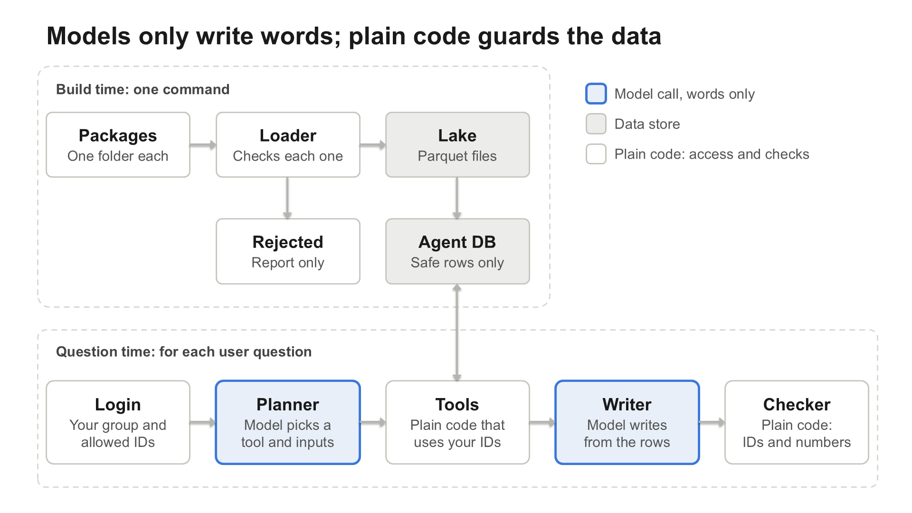

# BCF Data Hub: cited, access-controlled answers from lab experiment data

> A 3-day hackathon project (LabAI Hackathon, October 2026), built by a team of students with a university research facility (the BCF, Bioinformatics Core Facility). It turns a pile of experiment packages into a chat assistant that answers scientific questions **only from records the asker is allowed to see, and cites every claim by experiment ID**.
>
> The original repository is private to the faculty, so this repo holds the write-up only: the problem, the idea and the design. All data used in the hackathon was synthetic.



The editable PowerPoint version of this diagram is in [`docs/architecture.pptx`](docs/architecture.pptx).

---

## 1. The problem

A core facility runs experiments for many research groups across three domains: **flow cytometry, microscopy and metabolomics**. Each experiment is a folder of raw files, processed tables, a results card and free-text notes. Researchers want to ask things like:

- *"Has the spleen neutrophil response to LPS reproduced across our repeats?"*
- *"Is itaconate induction seen in both mouse and human?"*
- *"Which packages were rejected at load, and why?"*

Putting an LLM on top of this is risky in ways that matter for science and for privacy:

| Risk | What goes wrong |
| --- | --- |
| **Access** | A model that can see everything will eventually reveal a private experiment, or a patient's data, to the wrong person. |
| **Hallucinated numbers** | LLMs invent fold changes and p-values that look plausible. |
| **Bad statistics** | "Experiment A showed a bigger effect than B" is a claim that needs a test, not a glance at two numbers. |
| **Lost negatives** | A model tends to report only what was significant. "Tested, no effect" and "never measured" get mixed up. |
| **Dirty input** | Packages with a missing ID or a missing required field would silently corrupt answers. |

## 2. The idea

**Models only write words; plain code guards the data.**

The LLM is never trusted with anything that must be correct. It does two jobs: choose which *tool* to call, and phrase an answer from the rows that tool returned. Everything else is deterministic code:

1. **Access is enforced in code before the model sees anything.** The user's allowed experiment IDs come from the login session, never from the model, and every query goes through filtered SQL views.
2. **The model never writes SQL.** It picks one of a small set of typed tools and fills in arguments.
3. **Numbers are computed by SQL**, not read from text by the model.
4. **A checker verifies the answer** before it is shown: every cited experiment ID must have been returned by a tool, and every number in the text must appear in the tool output.
5. **When the data cannot answer, the system says so** instead of guessing.

## 3. How the solution is built

The system has two phases, as in the diagram above.

### Build time (one command)

```
experiment zip -> Loader (validate) -> Lake (Parquet) -> Agent DB (DuckDB)
                        \-> Rejected report
```

- **Loader / validator**: each package (a folder keyed by `experiment_uuid`) is validated. A package missing its UUID or a required field is **rejected with a reason** and reported, never loaded, and a missing value is never guessed.
- **Lake**: metadata, findings, measurements and text are stored as versioned **Parquet**. Every artifact carries its `experiment_uuid` inside it (a column plus Parquet file metadata), not just in the file name. Raw instrument files never enter the lake.
- **Agent DB**: one **DuckDB** file built from the lake. This is the only thing the application reads.
- **Reproducible**: the whole lake and agent DB rebuild from the zip with a single command.

| Table | One row per | Holds |
| --- | --- | --- |
| `experiments` | experiment | domain, PI, creator, group, date, access level, PII flag, summary |
| `samples` | sample | tissue, genotype, treatment/condition |
| `findings` | contrast x target | fold change, direction, p, adjusted p, significant |
| `measurements` | measured value | per-sample values, unit |
| `text_chunks` | piece of text | narrative, methods, deviations, embeddings |

"Not applicable" is stored as `NULL`, never `"N/A"`, `0` or `-1`.

### Question time (per user question)

```
Login -> Planner (LLM) -> Tools (code) <-> Agent DB -> Writer (LLM) -> Checker (code) -> answer
```

| Step | Kind | Role |
| --- | --- | --- |
| **Login** | code | Signs the user in and computes their allowed experiment IDs from role and research group. |
| **Planner** | LLM | Picks a tool and its arguments. At most 3 tool calls per question, then a final answer is forced. |
| **Tools** | code | Query filtered views (`v_*`), never base tables. Return rows. |
| **Writer** | LLM | Writes the answer from the returned rows only, citing experiment IDs. |
| **Checker** | code | Verifies citations and numbers against tool output. On failure: one retry, then "the data can't answer this." |

**Tools** include `find_experiments`, `get_findings`, `compare_repeats`, `aggregate_repeats`, `search_text`, `get_measurements`, `summarize_measurements`, `count_experiments`, `get_withheld_count` and `get_rejected_packages`. `search_text` is hybrid retrieval: BM25 keywords with synonym expansion (for example CD8 / cytotoxic T cells, KO / knockout) plus `nomic-embed-text` embeddings, merged by reciprocal rank fusion, falling back to keywords only if the embedding server is down.

## 4. Key design decisions

**Access control**
- `private` = the creator and their PI; `group` = the research group; `institution` = every signed-in user; the data steward sees everything except PII.
- **PII/PHI experiments** are loaded into the lake, but their content never reaches the model, for anyone. The agent DB keeps only a stub row so a tool can report "a match was withheld" as a **count**.
- Access is tested directly with a users x experiments matrix in `tests/`.

**Scientific honesty**
- **Compare direction and significance across experiments, not raw values.** The system does not say one experiment's result is larger than another's unless a test of that difference supports it. It shows fold changes and p-values side by side.
- **A repeat that disagrees is reported together with its recorded deviation.** It is not averaged away, and the system does not speculate about the cause.
- **Non-significant findings are kept.** An answer distinguishes three states: *significant effect*, *tested with no effect*, *never measured*.
- Summary means are allowed only through `aggregate_repeats`, which always carries each experiment's value, range and significance tally. "3 of 4 experiments" is a tally of evidence, not a meta-analysis.

**Engineering**
- The LLM runs through a single wrapper that talks to an OpenAI-compatible endpoint (Ollama, `qwen3` family for chat, `nomic-embed-text` for embeddings). The endpoint and model names live in `.env`, so the model can be swapped.
- The planner sees only a short preview of tool results while the writer gets the full rows. This fixed a context-overflow problem on broad questions.
- A Streamlit portal provides login, one question box, conversation history, search, download and an admin view for users and research groups.

## 5. Tech stack

Python, DuckDB, Parquet (PyArrow), Streamlit, Ollama (OpenAI-compatible API with tool calling), `nomic-embed-text`, pandas, pydantic, pytest.

## 6. Testing and evaluation

- **Access tests**: every user x every experiment, checking that nothing outside the allowed set, and no PII content, is ever returned.
- **Unit tests** for the loader and validation, query functions, search, synonyms, aggregation, planner/writer and the portal.
- **A 32-question benchmark** run end to end as named users. It covers lookups, quantitative questions, replication, cross-domain and cross-species questions, PII refusals, null results, time courses, confounding, synonyms, methods summaries, not-answerable questions, validation and aggregation.

## 7. My contribution

<!-- Fill this in before sharing. Be specific and honest, for example:
- Which stage you owned (lake / query / agent) and which files or features.
- One hard problem you solved and how (for example the checker, the filtered views, the portal).
- What you would do differently. -->

## 8. What I would improve

- Replace the regex-based number checker with a structured answer format (claims linked to tool-result row IDs).
- Add automated answer-quality evaluation to the 32-question run, not just pass/fail on errors.
- Move access rules to row-level policies in the database rather than per-session views.
